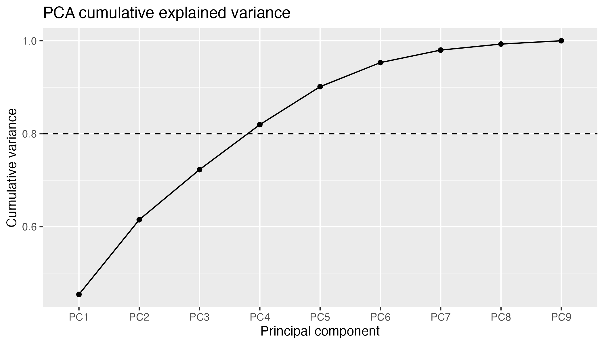
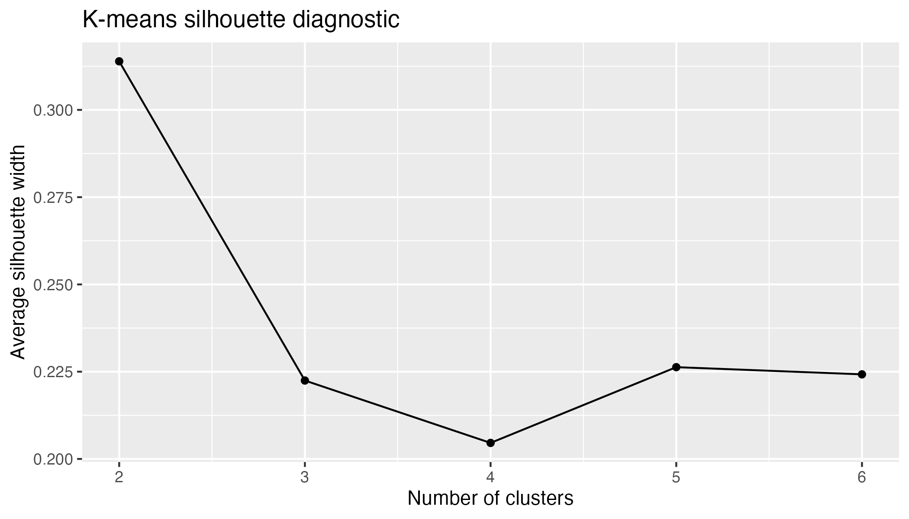
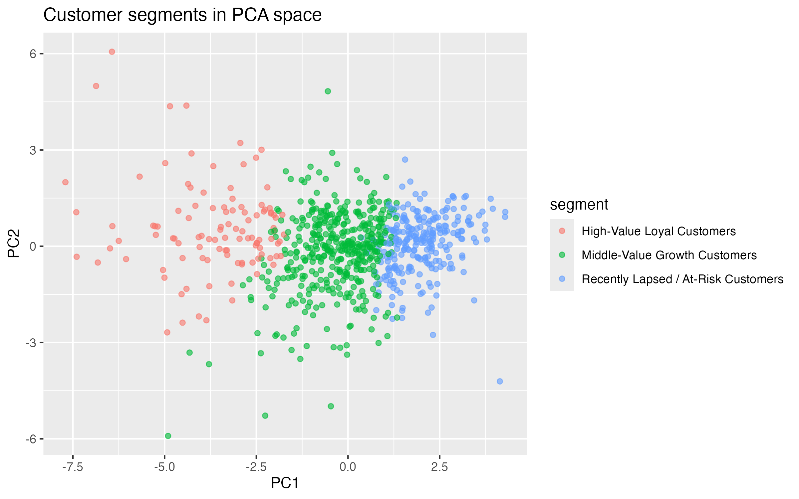
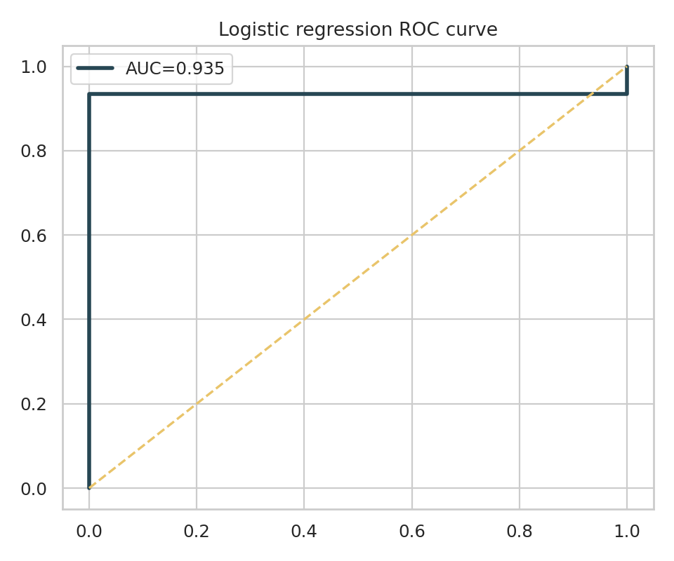
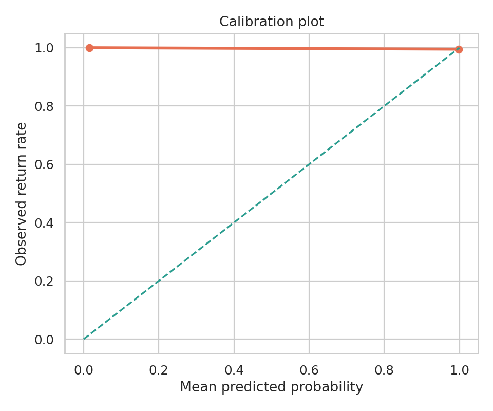

## Executive summary

### Research question

How should a retailer use household purchasing behavior to identify meaningful customer segments, estimate the probability that customers return, and allocate a fixed $1,000,000 marketing budget while balancing customer value, churn risk, growth opportunity, and marketing cost?

### Answer

Using the anonymized dunnhumby Complete Journey data, I created one row per household from January 1–September 30, 2017 and used October 1–December 31, 2017 as a holdout period. PCA showed that the first component summarized overall purchasing scale, with positive contributions from monetary value, product breadth, frequency, and items. K-means diagnostics were compared across k = 2 through k = 6. Although k = 2 had the highest silhouette score, k = 4 was selected because it provided four stable, sufficiently large, and actionable customer groups: 327 Low-Value Low-Touch Customers, 92 High-Value Loyal Customers, 53 Recently Lapsed / At-Risk Customers, and 329 Middle-Value Growth Customers.

The recommended budget is $250,000 for High-Value Loyal Customers, $400,000 for Middle-Value Growth Customers, $250,000 for Recently Lapsed/At-Risk Customers, and $100,000 for Low-Value Low-Touch Customers. Because the holdout return rate is extremely high, predicted return is not evidence of incremental marketing response. A randomized treatment/control experiment is required before concluding that spending caused additional purchases.

## Business question, unit of analysis, and time design

| Element | Definition |
|---|---|
| Unit of analysis | One household/customer |
| Feature period | January 1–September 30, 2017 |
| Holdout period | October 1–December 31, 2017 |
| Outcome | `retained = 1` if the household made at least one holdout-period purchase; otherwise `0` |
| Decision | Allocate exactly $1,000,000 across evidence-based segments |

The time split prevents holdout-period behavior from being used to construct predictors and avoids future-data leakage.

## Data source and large-data management

The analysis uses the public **dunnhumby Complete Journey** dataset distributed through the R `completejourney` package. It contains anonymized household transactions, household demographics, and product information. The analysis does not invent or simulate customers or transactions.

The full transaction table is too large to be stored as the small sample included in the package. The code uses `completejourney::get_transactions()` to download the full table when needed. The downloaded data are cached locally so the file does not need to be downloaded repeatedly. The script filters the feature and holdout periods before aggregation, then reduces approximately 1.47 million transaction rows to 801 household-level records. This reduces memory use during PCA, clustering, and modeling. The local data files are not required for GitHub reproduction because the R script can download them again.

The main data-management challenges were file size, repeated downloads, and the mismatch between transaction-level rows and the household-level modeling unit. The solutions were local caching, time filtering, aggregation before modeling, and explicit documentation of the date split.

## Customer-level feature construction

| Feature | Definition | Business meaning |
|---|---|---|
| Recency | Days from the last feature-period purchase to October 1 | Lower values indicate more recent engagement |
| Frequency | Number of distinct baskets | Repeat purchasing behavior |
| Monetary | Total sales value | Historical customer value |
| Average basket | Monetary value divided by frequency | Typical transaction size |
| Items | Total quantity purchased | Purchase volume |
| Distinct products | Number of unique products purchased | Product breadth |
| Category count | Number of departments purchased | Category breadth |
| Product-category count | Number of product categories purchased | Product-interest breadth |
| Family size | Household size from demographics | Household context |

The resulting customer-level file is `outputs/customer_level_features.csv`. It contains one row per household and includes the holdout outcome, cluster, segment, and predicted probability.

## PCA: summarizing customer behavior

The behavioral variables were standardized before PCA so variables measured on different scales did not dominate. PCA summarizes correlated behavior; it does not automatically label customers as good or bad.

### Explained variance

| Component | Explained variance | Cumulative variance |
|---|---:|---:|
| PC1 | 45.0% | 45.0% |
| PC2 | 16.0% | 61.0% |
| PC3 | 10.7% | 71.7% |
| PC4 | 9.9% | 81.6% |
| PC5 | 8.3% | 89.9% |

PC1 is interpreted as overall purchasing scale because its largest positive loadings include monetary value (0.463), distinct products (0.459), category count (0.386), items (0.294), and frequency (0.289). PC2 is most strongly associated with average basket size (0.684), with frequency contributing negatively (-0.528). PC4 is primarily a recency dimension because recency has a loading of 0.878. The complete loading table is in `outputs/pca_loadings.csv` and the complete variance table is in `outputs/pca_variance.csv`.

## K-means clustering and selection of k

K-means was run on the first five PCA scores for k = 2 through k = 6. Diagnostics included inertia, average silhouette width, minimum cluster size, and stability across five additional random starts. Stability is the adjusted Rand index compared with the reference solution; values closer to 1 indicate similar assignments.

| k | Inertia | Silhouette | Minimum cluster | Stability ARI |
|---:|---:|---:|---:|---:|
| 2 | 4481.9 | 0.311 | 276 | 1.000 |
| 3 | 3776.8 | 0.226 | 97 | 0.951 |
| 4 | 3405.0 | 0.237 | 53 | 0.985 |
| 5 | 3069.5 | 0.209 | 48 | 0.949 |
| 6 | 2790.0 | 0.211 | 34 | 0.958 |

The k = 2 solution has the highest silhouette score, but k = 4 was selected for the final business segmentation. The four-cluster solution has strong stability (ARI 0.985), no very small cluster (the smallest contains 53 households), and creates four distinct and actionable customer roles. This is a deliberate business tradeoff: k = 2 is statistically cleaner, while k = 4 better supports differentiated marketing actions. The full diagnostic file is `outputs/k_diagnostics.csv`.

## From clusters to business segments

K-means clusters are mathematical groups. The final business segments use the original variables to describe customer value and propose actions.

| Segment | Customers | Percent | Median recency | Median frequency | Median monetary | Return rate | Evidence and action |
|---|---:|---:|---:|---:|---:|---:|---|
| Low-Value Low-Touch Customers | 327 | 40.8% | 2 days | 46 | $1,164.16 | 100.0% | Lowest historical value; control costs with automated reminders and inexpensive seasonal communication |
| High-Value Loyal Customers | 92 | 11.5% | 0.5 days | 136.5 | $5,393.41 | 100.0% | Highest value and frequency; protect with recognition, early access, and relevant personalization |
| Recently Lapsed / At-Risk Customers | 53 | 6.6% | 18 days | 38 | $1,754.56 | 100.0% | Longest recency; test low-cost win-back actions and measure response |
| Middle-Value Growth Customers | 329 | 41.1% | 2 days | 71 | $2,654.20 | 99.4% | Meaningful value and room to grow; test bundles and cross-selling |

The high-value segment is called “loyal” because it has the highest value, highest frequency, and very recent purchasing. The recently lapsed/at-risk segment is labeled from its much larger median recency of 18 days; this is a risk signal, not proof that marketing will cause a return. The growth segment is not proven to be caused by promotions; the label describes a marketing hypothesis to test.

## Strategic marketing framework

The selected k = 4 solution identifies four observed groups that map naturally to the strategic framework. This prevents the analysis from treating every customer as if the same action were appropriate.

| Segment type | Strategic goal | Possible budget logic | How this project applies it |
|---|---|---|---|
| High-value loyal | Protect profitable relationships | Maintain meaningful but efficient investment; emphasize loyalty and relevant offers | The 92 High-Value Loyal Customers receive recognition, early access, and personalized cross-selling |
| Middle-value or growth | Increase future value and frequency | Give the largest experimental allocation because these customers may have room to grow | The 329 Middle-Value Growth Customers receive the largest experimental allocation for bundles and cross-selling |
| High-value at risk | Prevent valuable customers from lapsing | Fund targeted win-back actions, but measure whether they work | The Recently Lapsed / At-Risk group is monitored with win-back tests; future campaigns should prioritize members whose value and recency indicate the greatest risk |
| Low-value and unlikely to return | Control costs | Use low-cost or automated communication and minimize expensive outreach | The Low-Value Low-Touch group receives automated, inexpensive communication rather than costly incentives |

This framework is the bridge between statistical segments and business actions. It also explains why the absence of a separate cluster does not mean the business should ignore churn-risk or low-value customers; those groups should be monitored and handled with lower-cost rules when evidence identifies them.

## Logistic regression: predicting future return

The prediction question is: given information available at the end of the feature period, what is the probability that a household purchases during the holdout period? The model uses the original behavioral predictors and is evaluated on a held-out household sample. The probability cutoff is 0.50.

### Evaluation results

| Metric | Result |
|---|---:|
| ROC-AUC | 0.935 |
| Sensitivity | 0.995 |
| Specificity | 0.000 |
| Precision | 0.995 |
| Cutoff | 0.50 |

|  | Predicted 0 | Predicted 1 |
|---|---:|---:|
| Actual 0 | 0 | 1 |
| Actual 1 | 1 | 199 |

Specificity of 0.000 is a major limitation. Almost every household returned, so the model learned very little about distinguishing non-returners. A high AUC should not be interpreted as proof that the model can identify a large population that will not return.

### PCA, clusters, and multicollinearity

The original behavior variables are correlated: frequency, monetary value, items, and product breadth all describe related purchasing scale. This creates a multicollinearity risk in an ordinary logistic regression. PCA reduces this redundancy by replacing correlated variables with orthogonal component scores. Clusters provide a group indicator, but using clusters in regression would sacrifice information because customers inside a cluster receive the same label.

The original-variable model is retained for interpretability, while PCA is used for dimensionality reduction and clustering. The warning about fitted probabilities near 0 or 1 is evidence of quasi-separation caused by the very small non-returner group. Model results should therefore be treated as ranking evidence, not causal evidence.

As a sensitivity check, the original-variable model had AUC 0.935 and a model using the first five PCA scores had AUC 0.850 in the same held-out comparison. The original model was retained because it performed better in this run and its predictors are easier to explain. The largest pairwise correlation among the original features was between distinct products and product-category count (approximately 0.896), confirming that multicollinearity is a real concern. These comparison results are saved in `outputs/model_comparison.csv` and `outputs/max_correlation.csv`.

## $1,000,000 marketing allocation

| Segment | Customers | Predicted return rate | Median value | Marketing action | Allocation | Percent of budget | Justification |
|---|---:|---:|---:|---|---:|---:|---|
| High-Value Loyal Customers | 92 | 98.8% | $5,393.41 | Recognition, early access, personalized cross-sell | $250,000 | 25% | Protects profitable relationships without wasting budget on blanket discounts |
| Middle-Value Growth Customers | 329 | 99.9% | $2,654.20 | A/B-test bundles, cross-selling, and moderate incentives | $400,000 | 40% | Largest allocation because this group has meaningful value and room to grow |
| Recently Lapsed / At-Risk Customers | 53 | 100.0% | $1,754.56 | Low-cost win-back test with response measurement | $250,000 | 25% | Tests whether the longest recency gap can be changed without overspending |
| Low-Value Low-Touch Customers | 327 | 99.7% | $1,164.16 | Automated reminders and low-cost seasonal communication | $100,000 | 10% | Maintains contact while controlling expensive outreach |
| **Total** | **801** |  |  |  | **$1,000,000** | **100%** |  |

The allocation is not equal because the segments have different historical value and strategic opportunity. The growth segment receives more money for experimentation, not because its predicted return is higher. Both predicted return rates are already high, so the key uncertainty is incremental response. Success should be measured using incremental purchases, incremental revenue, profit after marketing cost, cost per incremental purchaser, and return on marketing investment.

The recommended experiment is a randomized controlled test within each segment. Half of eligible customers would receive the segment-specific action and half would receive normal or no additional communication. The difference in purchases and profit estimates the causal effect of spending.

## Limitations, ethics, and additional information needed

This dataset is anonymized and observational. It does not provide profit margins, contact costs, offer-level treatment assignment, or individual causal response. Household demographics should be used carefully so marketing does not unfairly exclude or exploit groups. The high holdout return rate limits classification of non-returners and makes calibration especially important. Better decisions would use profit margin, contact cost, campaign history, coupon response, communication channel, and experimental incremental-response data.

## Reproducibility and project structure

Run `project3_analysis.R` from the RStudio Project. It installs missing packages, downloads the large transaction file through `completejourney::get_transactions()`, creates the customer-level data, runs PCA, evaluates k-means solutions, fits logistic regression, writes tables, and creates figures. The Quarto source is `project3_report.qmd`; the viewable report is `project3_report.html`. The README documents reproduction, data management, and limitations.

## Required-question summary

1. **PC1:** overall purchasing scale, supported by monetary, product-breadth, category, item, and frequency loadings.
2. **k:** k = 4 was selected because it provides four stable, sufficiently large, and actionable customer groups. k = 2 had the highest silhouette score, but k = 4 better supports differentiated marketing actions and the required strategic framework.
3. **Clusters versus segments:** clusters are mathematical assignments; segments add business meaning and actions.
4. **Most valuable versus growth opportunity:** High-Value Loyal Customers are most valuable; Middle-Value Growth Customers have more room to increase value.
5. **Most likely to return:** customers with recent, frequent, high-value, broad purchasing histories.
6. **Why not spend most on highest predicted return:** they may buy without marketing, so incremental opportunity may be small.
7. **Why not equal allocation:** value, risk, responsiveness, contact cost, and growth opportunity differ.
8. **Assumptions:** past behavior informs future behavior and targeted offers may change behavior.
9. **Additional information:** margins, contact costs, offer response, campaign history, channel, and experiments.
10. **Causal test:** randomized treatment/control groups within each segment.
